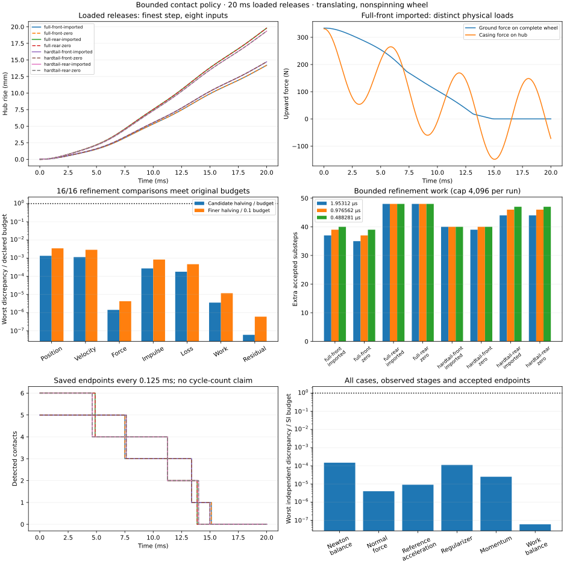

# Loaded-wheel cross-check of the contact policy — received 2026-11-03

**All 24 runs and 16 timestep comparisons pass under the original budgets. Twenty focused tests pass.** The [receipt](evidence/casing-contact-loaded.json) records complete inputs, compiled models, source/record/grid hashes, physical checks and verified cache consolidation.

This study applies the bounded contact-substep and native solver policy received by the [entry/recontact controls](CASING_ENTRY.md) to all eight supplied wheel inputs: front/rear on both bikes, with imported/zero relative rates. Each input runs for 20 ms at 1.953125, 0.9765625 and 0.48828125 µs. The 24 runs produce 16 adjacent-step comparisons on the complete common coarse grid, with 10,241 samples in each comparison.



Maximum position discrepancy is 1.34e-10 m, velocity discrepancy 1.14e-7 m/s, force discrepancy 7.08e-8 N and contact-work discrepancy 3.56e-12 J. Every finer comparison also meets its one-tenth budget. Across the complete study, maximum work-balance residual is 5.99e-14 J, linear momentum closure error 2.50e-13 N s and independent Newton-balance error 1.48e-12 N. Native/reconstructed stage discrepancies are zero. All runs reach full separation.

Each run uses 35–48 extra accepted substeps and the same number of discarded contact trials. All reach the permitted depth of eight bisections, with five transition-limited accepted leaves for front inputs and six for rear inputs. Thus these cases pass the unchanged error budgets with the bounded event resolution; they do not establish continuous collision detection or qualification for every possible contact history. Work counts are not timing or real-time measurements.

The original absolute budgets remain position 1e-7 m, velocity 1e-4 m/s, force 0.05 N, impulse 1e-5 N s, and loss/work/residual 1e-6 J each. The finer comparison must meet one tenth of each budget. Native stages, independent forces/contact law, mass, momentum and all physical guards remain required. Every run retains the cap of eight bisections and 4,096 extra accepted substeps. No material law or product default changes.

```sh
node --test --test-isolation=none test/casing-contact-loaded.test.mjs
node scripts/casing-contact-loaded.mjs artifacts/casing-contact-loaded-20ms .02
```

The runner prints accepted-case progress and writes an atomic report after every completed case. A checkpoint commits the complete JSON record plus its common-grid trajectory in little-endian float64 form, with SHA-256 hashes, shape, model/native/policy identity, inputs, compiled XML and source hashes. Repeating the same command verifies and reuses completed cases, recomputing comparisons from the saved grids. Partial files without a checkpoint are recomputed; stale or changed checkpoints are rejected. Failed cases remain failed evidence, with the accepted prefix preserved. This is case-level study resumption, not restart from an arbitrary native integration state.

Four focused tests cover exact numeric-grid resumption and rejection of changed inputs, duration, sources, records, binary data and encoding; terminated-prefix resumption; disjoint complete study partitions; and complete unique matrix coverage with mandatory physical/refinement gates. The synthetic matrix in the gate test is explicitly not a physics result.

The combined [20-test receipt](evidence/casing-contact-loaded-tests.json) also covers translating controls, analytic contact entry, Newton accuracy, stage identity, trace analysis and transactional/work-cap rollback. This is focused local verification, not a full Node/browser/hosted attestation. The recorded scientific PNG was inspected for SI units, distinct physical loads, original refinement fractions, bounded work and separation. No product browser check is claimed.

GPT-6.1 Sol's review found that the first writer saved unused trajectory capacity after termination, while the reader required only the accepted prefix. The corrected writer saves exactly `count*width` values. A warning injected after four accepted intervals verifies failed-state/prefix recovery without repeating integration. The preliminary sequential study was stopped and retained under `artifacts/casing-contact-loaded-pre-review`; all final measurements restarted with unchanged dynamics and corrected storage sources at remote `f595805`.

Independent partitions may run in separate processes. Each owns disjoint whole timestep ladders and a separate report; use one shared directory and identical duration/sources. Wait for both to exit before running the normal command to verify all caches and recompute the full 24/16 matrix. Do not overlap two writers for the same partition or run the full command concurrently with partitions.

```sh
# In two separate processes; numerical validation, not a performance benchmark:
node scripts/casing-contact-loaded.mjs artifacts/casing-contact-loaded-20ms .02 0/2
node scripts/casing-contact-loaded.mjs artifacts/casing-contact-loaded-20ms .02 1/2
# After both finish:
node scripts/casing-contact-loaded.mjs artifacts/casing-contact-loaded-20ms .02
```

Partition reports deliberately fail full-matrix coverage. A partition's successful exit means its own runs and available comparisons passed, not that the complete study is received. Only the assembled `report.json` can supply the full coverage gate.

Both final partitions completed. The unpartitioned consolidation exited successfully, verified and reused all 24 record/grid checkpoints, and recalculated all 16 comparisons without integrating any case. All complete-matrix gates pass. The receipt preserves separate partition and consolidated report/log hashes; source hashes remain unchanged throughout.

Source hashes cover the runner, translating/contact scripts, top-level runtime modules, fixtures and pinned native JS/WASM. These files stay fixed throughout the measured study. Save full records and grids under ignored artifacts; commit compact evidence with case/input/source hashes and scientific plots after receiving. Timing and extra substep counts are not real-time performance evidence.

This loaded contact-policy cross-check is complete. It remains a translating, nonspinning flat-contact release of a 1.5 kg hub and 1 kg casing, not a supported whole bike or idle rider. Next follow the [spin plan](SPINNING_HUB_PLAN.md), beginning with the prescribed-state physical-gap-acceleration isolation, then receive both connected bikes, held-control/constitutive work and active rider stability. Faceted/layered terrain, component failure and pressure loss, physical calibration, browser execution, 3D and game performance retain their separate gates. The user has requested merging this bounded checkpoint; [the handoff](PR54_HANDOFF.md) preserves software checks and the unfinished physics gates.
