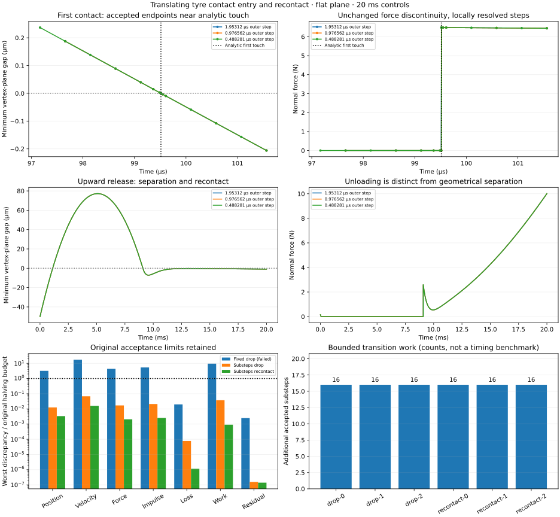

# Translating tyre contact entry and recontact — 2026-11-03

**The bounded contact-step correction now passes all six 20 ms runs and all four timestep comparisons, including analytic first entry and a complete separation/recontact cycle. Sixteen focused tests pass.** The [final receipt](evidence/casing-entry.json) preserves the measured study and the separate reviewed receiving checks.



The original synthetic drop exposed a failed receiving gate that the earlier unloading/separation controls did not exercise. The unchanged fixed-step model completes all three 20 ms runs, but **both timestep comparisons fail**. The [baseline receipt](evidence/casing-entry-baseline.json) preserves the full input, source/case hashes, summaries and failures at remote `7693df1`.

The control has 64 undeformed casing nodes, zero relative rates, an unrotated hub 10 µm above flat ground, common downward velocity 0.1 m/s and gravity 9.80665 m/s². Hub and casing masses remain 1.5 and 1 kg. Donor provenance identifies parameter lineage, not an observed bike state. Before contact, the exact gap is `10e-6 - 0.1*t - 9.80665*t²/2`, reaching zero at approximately 99.5144 µs.

Across the existing 1.953125/0.9765625/0.48828125 µs ladder, the two maximum velocity discrepancies are 3.48013e-4 and 1.73985e-4 m/s; contact-work discrepancies are 1.94372e-6 and 9.52424e-7 J. The second comparison must meet one tenth of the original budgets. Native/reconstructed stages agree exactly; small work residual alone does not qualify convergence. These drops enter contact but do not fully separate/recontact within 20 ms.

Native contact excludes nonadhesive rows at nonnegative gap. Just inside, the reference damper produces finite upward force for a closing vertex. This discontinuity makes fixed-step RK4 depend on event phase even when its smooth-force/stage reconstruction is correct. Intermediate RK states are predictors: stage 2 and 3 share a time but differ in position even under constant gravity. Their contact toggles must not be counted as physical cycles or compared to exact ballistic positions at those times.

## Implemented bounded correction

The separately identified diagnostic policy retains the native contact law and RK4, but bisects a candidate step when active vertex identity changes across its four reconstructed stages or actual endpoint. It admits at most eight bisections and 4,096 extra accepted substeps over a run. The original external/output clock and all original refinement, force, energy, momentum, geometry and rollback budgets are retained. Product defaults remain unchanged.

Each accepted substep receives the same native/stage comparison and independent physical checks. Discarded predictor/contact trials contribute no work, impulse or accepted maxima. A failed macro interval restores its initial integration state, warm start and all accepted records/ledgers. Bisection is a bounded numerical control, not continuous collision detection or proof that all possible hidden contact excursions are found. The exhaustion regression confirms that the work cap terminates at the last accepted interval.

Accepted endpoint contact cycles are recorded separately from ordered stage observations. Initial free flight is checked only over steps whose complete stage set remains contact-free. Accepted endpoints bracket the analytic first-touch time; stage disagreements remain numerical evidence. The drop has no complete cycle, so the separately specified upward-release control below receives separation and recontact.

The correction uses `bikelab-translating-hub-contact-rk4-diagnostic-0.1`. The [16 focused tests](evidence/casing-entry-tests.json) cover the prior translating checks, exact flight/entry, unchanged refinement budgets, tracing/replay independence, a warning after an accepted interior substep, work-cap rollback, solver accuracy, zero-gap separation, explicit momentum/coverage gates, policy identity and archived trace integrity.

## Completed study and evidence boundaries

All three runs of each synthetic control complete. All four common-grid comparisons pass their original absolute budgets; the finer halving still receives one tenth of each limit. Maximum velocity discrepancy is 7.92e-7 m/s, force discrepancy 8.47e-5 N and contact-work discrepancy 3.72e-9 J. Maximum work residual is 4.92e-14 J and momentum closure error 1.94e-13 N s. Native/reconstructed stages agree exactly. Independent force-balance error remains below 2.21e-12 N.

The analytic first-entry time falls within every accepted substep bracket. The finest bracket is approximately 99.514008–99.515915 µs. The upward release separates at approximately 1.117633 ms and recontacts at approximately 9.080619 ms; these are bounded event brackets, not exact event-time claims. All six runs require 16 extra accepted substeps and 16 discarded contact trials. These counts are not a wall-time or real-time benchmark.

Dynamics and common-grid numeric comparisons were measured at remote `9d473d5`, with complete source hashes unchanged throughout the study. Review then added an explicit momentum gate, unique case/refinement coverage, strict comparison policy identity and recognition of positive-gap flight after an exact zero-gap endpoint. The archived receiver verifies complete record and binary-trace hashes and reruns endpoint analysis; the actual study's event analyses remain unchanged. It explicitly attributes the numeric refinements to the original run instead of claiming a repeated physics study. The final focused tests cover the reviewed code.

The scientific PNG was inspected for SI units, analytic entry, force discontinuity, geometrical separation/recontact, unchanged budgets and work counts. This is a visual consumer of saved diagnostic records, not product browser receiving.

```sh
node --test --test-isolation=none test/casing-entry.test.mjs test/casing-translate.test.mjs
node scripts/casing-entry.mjs artifacts/casing-entry-substeps substeps all
node scripts/casing-entry-receive.mjs artifacts/casing-entry-substeps
MPLCONFIGDIR=/tmp/bikelab-matplotlib XDG_CACHE_HOME=/tmp/bikelab-plot-cache python scripts/plot-casing-entry.py artifacts/casing-entry-substeps
```

This contact-entry/recontact activity is complete. Before extending the corrected path, cross-check the new substep/solver policy against the supplied loaded-wheel release set, then receive spin and connected bikes under the [broader correction plan](CASING_FIX_PLAN.md) and [spinning-hub plan](SPINNING_HUB_PLAN.md). Long-idle rider stability, physical calibration/failure, faceted/layered terrain, product browser receiving, eventual 3D dynamics and measured game performance remain separate gates.

## Low-force Newton stopping

The separate recontact control begins with 50 µm compliant overlap and common upward speed 0.05 m/s, zero relative displacement/rates and the same gravity/material. This is a controlled upward release, not a settled support state. The original native tolerance `1e-10` fails the unchanged `1e-8 N` independent Newton-balance guard at approximately 26.37 µs: residual `3.17e-6 N`. A forensic `1e-12` override also fails; `1e-14` completed the short probe but does not supply an absolute force-error guarantee. The [probe note](evidence/casing-entry-solver.json) distinguishes these exploratory measurements from final-source receiving.

The pinned [Newton termination code](https://github.com/google-deepmind/mujoco/blob/a892750516336d8358949f4518fcc4fbbd85beae/src/engine/engine_solver.c#L2995) may exit after an iteration on scaled improvement or Newton decrement, without requiring the independent force-balance threshold. Its initial certificate is gradient-gated, but the later decrement branch is not. A small cost/decrement therefore does not imply our absolute force accuracy.

The new diagnostic policy records native solver tolerance `1e-20` in its identity and XML. This is a numerical-accuracy choice, not a changed contact/material law. The original absolute balance/force guards remain mandatory at every observed stage and accepted substep; no solver tolerance is presented as a universal force-error guarantee. Legacy fixed-step records retain their original native solver setting.

Contact traces use little-endian float64 rows: one initial endpoint, then four ordered RK predictors and one accepted endpoint per committed substep. The sidecar specifies all columns, row count and SHA-256. A rejected macro interval discards its trial trace and restores the prior accepted state and ledgers, while attempted warning and work diagnostics remain separately identified. Progress remains on accepted macro intervals. The finer-step cost is bounded and reported; this is not a real-time benchmark.
