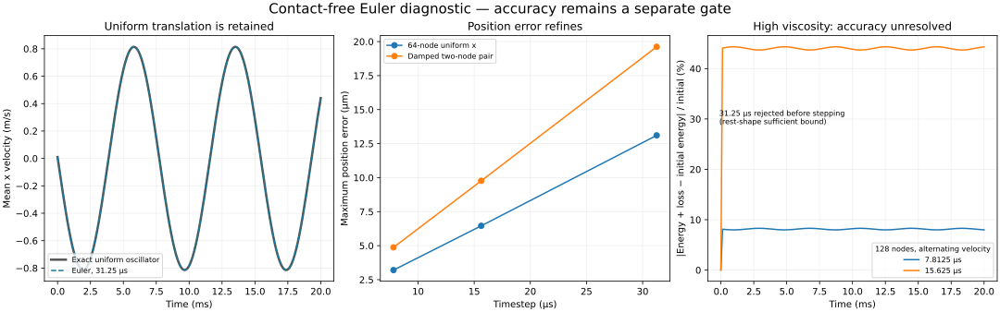

# Contact-free Euler candidate — 2026-10-29

**The isolated Euler candidate preserves uniform casing motion with edge viscosity active, but is not qualified for production.** A high-viscosity, 128-node control still has a substantial energy-plus-loss discrepancy at the finest tested timestep. This is a bounded continuation of the [native derivative diagnosis](CASING_DERIVATIVE.md), not a change to the bike, tyre material, native binary or legacy record semantics.

## Reproduce and inspect

```sh
node scripts/casing-euler.mjs artifacts/casing-euler
node --test --test-isolation=none test/casing-euler.test.mjs test/casing-derivative.test.mjs test/tyre-fixture.test.mjs test/tyre-fixture-observation.test.mjs test/tyre-fixture-ui.test.mjs
MPLCONFIGDIR=/tmp/bikelab-matplotlib python scripts/plot-casing-euler.py artifacts/casing-euler
```

The study prints progress for 29 cases. It writes complete authored inputs, compiled coefficients, native version, source/XML hashes, accepted endpoint state and sampled observations. `completed` means integration reached 20 ms within the diagnostic guards; it does **not** mean accuracy qualification. One case is rejected before stepping by the sufficient rest-shape bound. An expected admission rejection does not fail the study command; an unexpected termination or recorded native warning exits 2. Assertion/execution errors exit 1.

The separate identity is `bikelab-contact-free-euler-trial-0.1`. These files are **not** legacy fixed-hub viewer records. Their current visual consumer is the optional Matplotlib plotter (tested with 3.10.8), which uses recorded mean motion, independent oscillator values, every-step error maxima and sampled energy accounting. The PNG was actually inspected: axes, units, legends, reference overlay, refinement trend and the unresolved high-viscosity discrepancy are visible. This is scientific figure inspection, not browser receiving or interactive wheel visualization.



## Native scheme and independent model

The actual MuJoCo 3.16.0 source was read at commit `a892750516336d8358949f4518fcc4fbbd85beae`. [Euler integration](https://github.com/google-deepmind/mujoco/blob/a892750516336d8358949f4518fcc4fbbd85beae/src/engine/engine_forward.c#L1510) treats joint/DOF damping specially; these fixtures have none. It therefore uses the full acceleration, including [passive edge damping](https://github.com/google-deepmind/mujoco/blob/a892750516336d8358949f4518fcc4fbbd85beae/src/engine/engine_passive.c#L729), explicitly. [State advancement](https://github.com/google-deepmind/mujoco/blob/a892750516336d8358949f4518fcc4fbbd85beae/src/engine/engine_forward.c#L1470) updates velocity and then position using that new velocity. It does not use the incomplete `qDeriv` operator identified in the preceding audit.

For the constant linear reference, with position q, velocity v, mass M, positive spring matrix K and positive semidefinite damping C:

```text
v+ = v − h M⁻¹(Cv + Kq)
q+ = q + h v+
```

The diagnostic independently reconstructs each edge's extension, length rate, damping force and dissipation from world x/z geometry. It compares that force to native `qfrc_damper`, and spring-plus-kinetic energy to native energy. All coordinates are SI; edge coefficients are N/m and N s/m. The authored wheel's `edgeViscosity` is N s, converted by the existing reference-length law. Hub/world axes coincide here. The native model must compile with Euler, zero gravity, expected slide axes/body/vertex mapping, ring or pair connectivity, zero spring references and diagonal mass equal to the node masses. Changed topology/coordinate assumptions fail assertions rather than silently reuse this reference.

Three independent arms prevent merely disabling damping from appearing to fix the problem:

- Uniform x and z translation: an undamped foundation oscillator because every edge length rate is zero. Ring meshes have 32, 64 and 128 nodes; edge viscosity is 0.5 N s, plus separate 64-node zero-viscosity controls.
- Alternating x velocity: a genuinely dissipative ring, with zero initial displacement, ±0.01 m/s node velocity, and either 64 nodes/0.5 N s or 128 nodes/3 N s. There is no claimed closed-form nonlinear trajectory reference for this arm.
- Two collinear nodes: an exactly linear, damped relative oscillator. Each node has mass 0.015625 kg and foundation stiffness 10000 N/m; the connecting edge has stiffness 15000 N/m and damping 15 N s/m. Initial node positions relative to rest are ±1 mm and velocities ±0.01 m/s. Its amplitude obeys `m a'' + 2c a' + (k + 2ke) a = 0`, checked against the existing independent closed-form oscillator.

The ring uses the prior diagnostic's authored, contact-free inputs and unchanged 0.36 m radius. Source-bike fields identify lineage, not an unchanged transferred bike state. The pair is an illustrative verification fixture, not a physical tyre calibration.

## Damping-dependent admission

A stiffness-only rule is insufficient for this explicit edge force. Direct algebra for the constant linear scheme gives the modified energy

```text
E_h = ½vᵀ(M − hC/2)v + ½qᵀKq − h qᵀKv/2
ΔE_h = −h (v+ + v)ᵀ C (v+ + v)/4.
```

No commutation of K and C is needed. A positive modified energy requires `M − hC/2 − h²K/4` positive definite. For equal node masses, a sufficient condition is

```text
h² kBound / m + 2h cBound / m < 4.
```

At rest, the ring's degree-two edge network gives `kBound = k + 4ke`, `cBound = 4c`; the pair uses factors of two. The script uses compiled coefficients and a strict inequality. This is only a **constant linear/rest-shape sufficient bound**. It does not certify nonlinear prestress, varying edge directions, contacts or the connected mass matrix; failing it does not itself prove instability. Physical energy need not decrease at every discrete step. The pair's independently evaluated modified-energy balance agrees to 8.61e-16 J over all three timesteps.

At 128 nodes and viscosity 3 N s, the existing stiffness indicator is about 0.123, below its 0.55 limit, but the combined score is **5.57163**, above four. The candidate rejects this 31.25 µs step before integration. The 15.625 and 7.8125 µs scores are 2.78204 and 1.39007; admission still says nothing about their accuracy.

## Results and remaining gap

All 28 admitted trajectories reach 20 ms with no native warnings; the remaining case is rejected as intended. Observations and work are evaluated on every accepted step, while output frames are sampled at 125 µs. Scratch/record slots are allocated before integration. Contact/constraint entry, nonfinite state, ring strain/displacement/movement and pair displacement limits retain accepted dynamics/work on rejection. Native warning counters are reported at the end, including any rejected attempt; warning/solver bookkeeping is not rolled back or claimed as a resumable native state.

For 64-node uniform x motion with viscosity 0.5 N s:

| Quantity | 31.25 µs | 15.625 µs | 7.8125 µs |
| --- | ---: | ---: | ---: |
| Maximum nonuniform RMS velocity, m/s | 1.15e-15 | 1.23e-15 | 1.22e-15 |
| Maximum position error, µm | 13.1083 | 6.4590 | 3.2057 |
| Maximum velocity error, m/s | 3.47234e-4 | 9.55919e-5 | 3.41514e-5 |
| Maximum `abs(E + loss − E0)`, J | 0.00427226 | 0.00214965 | 0.00107824 |

This retains the uniform mode that the native implicit derivative destroyed. It still has ordinary integration error: reference agreement is not exact trajectory equality. Refinement reduces position/energy errors for all uniform mesh/axis cases and for the damped pair. The pair's maximum position errors are 19.6188, 9.76828 and 4.87467 µm; its damping remains active and dissipates almost all initial energy by 20 ms.

For the alternating ring, the ledger integrates actual geometric dissipation by the trapezoidal rule. Its discrepancy combines trajectory integration and loss-quadrature errors; it is not alone proof of physical energy creation:

| Ring configuration | 31.25 µs | 15.625 µs | 7.8125 µs |
| --- | ---: | ---: | ---: |
| 64 nodes, viscosity 0.5 N s: maximum discrepancy / initial energy | 3.296% | 1.707% | 0.868% |
| 128 nodes, viscosity 3 N s: maximum discrepancy / initial energy | Rejected | **44.329%** | **8.298%** |

Initial energy for these rings is only 5e-5 J, so the corresponding high-viscosity absolute discrepancies are 2.21647e-5 and 4.14912e-6 J. The errors decrease, but the available refinement does not establish a converged high-viscosity reference. No acceptance tolerance was enlarged to call this a pass.

## Evidence and next increment

The [machine-readable receipt](evidence/casing-euler.json) contains complete case inputs, compiled coefficients, summaries and artifact/source hashes. Seventeen focused tests pass without failures/skips, covering independent force/energy checks, active damping, exact oscillator refinement, timestep rejection, deterministic repeat, injected-failure rollback and native-warning reporting. GPT-6.1 Sol reviewed the source mapping, force/energy algebra, admission assumptions and rollback. Performance was not measured. No full local attestation, browser/headless agreement for this new identity, hosted test or deployment is claimed. PR54 remains draft and the [CI pause](CI_WORKFLOW.md) remains in force.

Next isolate the high-viscosity integration and loss-quadrature errors with a finer diagnostic reference before selecting a production treatment. Any further timestep range belongs to that separate diagnostic; do not loosen production admission. Then compare a coupled or damping-aware candidate if the required explicit step is impractical. Only an accuracy-qualified candidate should proceed to loaded fixed-hub contact and connected-bike perturbation/replay, with compatible moving-hub mass/reactions, accepted-step command timing, work/impulse and hard physical limits. This result does not establish long-idle rider stability, realistic damage, layered terrain, 3D dynamics or game-rate performance.
