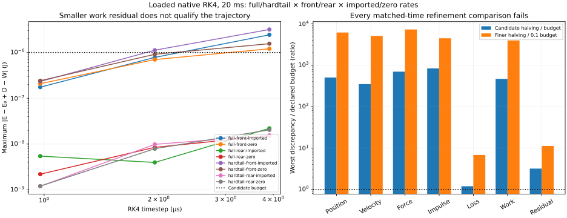

# Loaded RK4 correction attempt — 2026-10-29

**All 24 runs complete, but all 16 loaded refinement comparisons fail.** Exact agreement between native RK4 and reconstructed stages establishes the accounting implementation, not trajectory accuracy. The new fixed-hub runtime remains explicitly experimental. The [complete correction plan](CASING_FIX_PLAN.md) tracks the remaining contact, connected-bike, idle and receiving gates.

This follows the [contact-free RK4 screen](CASING_RK4.md). Four supplied loaded wheels (front/rear, full suspension/hardtail), imported and zero velocities, and steps of 3.90625, 1.953125 and 0.9765625 µs run for 20 ms. Parameters, seed provenance and physical guards are unchanged. Each candidate endpoint is compared on the common 3.90625 µs grid; this is denser than the plotted/save-frame cadence. Each trajectory also measures its maximum energy/work residual at every accepted endpoint.

Before this sweep, absolute SI budgets were fixed at 1e-7 m position, 1e-4 m/s velocity, 0.05 N vertical force, 1e-5 N s impulse, and 1e-6 J for each loss, contact work and residual. The finer halving must fit one tenth of each budget. These are numerical targets, not calibrated physical tolerances. No threshold was raised to admit these failures.



The final Matplotlib PNG was actually inspected: units, eight case labels, candidate residual budget, two refinement groups and normalized failure bars are readable. This is a scientific consumer, not browser verification. The [receipt](evidence/casing-loaded.json) records all eight complete authored inputs once, 24 output hashes/summaries, all 16 comparisons, budgets and source hashes.

For example, full-front imported motion has maximum balance residuals 2.436e-6, 7.818e-7 and 1.749e-7 J as steps shrink. Yet adjacent-run discrepancies reach approximately 37.5/42.0 µm position, 0.0163/0.0288 m/s velocity and 29.2/29.3 N vertical force. The full-front zero-rate finer comparison reaches 61.6 µm, 0.0507 m/s and 29.4 N. Smaller balance residuals therefore cannot justify rollout. Rear-wheel cases also fail the declared trajectory and force budgets.

## What is implemented

`dist/casing-rk4-observer.js` reconstructs native force stages in a separate preallocated `MjData`, starting from each native pre-step integration state. It never feeds predicted state into the native solver. The pinned [RK4 source](https://github.com/google-deepmind/mujoco/blob/a892750516336d8358949f4518fcc4fbbd85beae/src/engine/engine_forward.c#L1610) keeps the pre-step warm start unchanged through all four stages, then [saves fourth-stage acceleration](https://github.com/google-deepmind/mujoco/blob/a892750516336d8358949f4518fcc4fbbd85beae/src/engine/engine_forward.c#L1486). The observer checks both endpoint q/v and stage-four acceleration, damping/contact forces and warm start before endpoint forward evaluation overwrites them. All these differences are exactly zero throughout the 24-case sweep.

Independent Cartesian geometry reconstructs foundation/edge elastic energy, gravity, kinetic energy, full passive force and edge damping power, including rotated fixed hubs. Generalized contact power `qvel · qfrc_constraint` is independently compared with constraint-space `efc_force · efc_vel`. Native normal forces remain the contact law being examined; this is not an independent contact solver.

The accepted ledger is `E−E₀+D−W_contact`. Stage-weighted damping loss is nonnegative; contact work is signed and is not labelled dissipation. Gravity and spring storage are already in `E`; the stationary clamp does zero work. Contact compliance has no separately established storage/loss decomposition here.

All intermediate geometries are checked relative to the common pre-step state. Finite state, strain, casing/rim clearance, penetration, displacement, motion resolution, contact capacity, normal rows, every solver island and warnings are guarded. Only accepted trials contribute work, frames or extrema. Integration state is restored after rejection; attempted warning/solver bookkeeping is not advertised as a resumable checkpoint. Native warning bindings require short-lived owned wrappers; solver scratch, stage arrays and recording storage are preallocated.

The new runtime identity `bikelab-fixed-hub-casing-rk4-0.1` exposes an explicit numerical policy and conservative small-step choices in the fixture worker/viewer and CLI. Input and replay reject a mismatched policy or a legacy model discriminator. Existing legacy inputs retain their original integrator and ledgers. The experimental selector is available, but fresh-run defaults remain legacy comparison until a loaded path qualifies. Moving-wheel and connected-bike stepping are not corrected by this fixed-hub path.

## Verification and reproduction

Thirty-eight focused tests pass with zero failures/skips. They cover both wheels/bikes and velocity controls, independent rotated force/energy/power maps, unchanged native stepping, nonzero fourth-stage warm starts, exact repeat/replay, a uniform damping null mode against the exact oscillator, numerical policy admission, first/later/off-grid rejected prefixes, intermediate-stage failure, stale-backup prevention, initial/native warnings and other-island limits, and world-height datum invariance. Existing derivative, reference, Euler and legacy fixture checks remain green.

```sh
node scripts/casing-loaded.mjs artifacts/casing-loaded-long .02
node --test --test-isolation=none test/casing-loaded.test.mjs test/tyre-fixture-rk4.test.mjs test/casing-rk4.test.mjs test/casing-refinement.test.mjs test/casing-euler.test.mjs test/casing-derivative.test.mjs test/tyre-fixture.test.mjs test/tyre-fixture-observation.test.mjs test/tyre-fixture-ui.test.mjs
MPLCONFIGDIR=/tmp/bikelab-matplotlib XDG_CACHE_HOME=/tmp/bikelab-plot-cache python scripts/plot-casing-loaded.py artifacts/casing-loaded-long
```

The study exits 2 when cases fail completion or refinement. Its recorded failed comparisons are the result, not a test-run success. The original long process loaded modules before subsequent runtime edits; its original end-of-run source collector saw those later files. The receipt corrects only that metadata using retained [actual loaded module snapshots](evidence/casing-loaded-source) and the pre-edit fixture at `0f7da12`. To reproduce that exact source, copy the three snapshot files over their corresponding paths in a copy of that baseline. Raw numerical outputs and their hashes are unchanged. Snapshot files are evidence, not application imports.

The extended browser receiver covers the new selector, worker record replay, export/reimport and desktop/mobile captures, but has not executed: this environment denies loopback listening with `EPERM` and supplies Playwright 1.62.1 rather than pinned 1.56.1. No new browser, full-local, hosted, performance or deployment pass is claimed. PR54 remains draft under the [CI pause](CI_WORKFLOW.md).

## Next cause isolation

The pinned [plane-flex path](https://github.com/google-deepmind/mujoco/blob/a892750516336d8358949f4518fcc4fbbd85beae/src/engine/engine_collision_flex.c#L215) computes a normal gap and row for each vertex, while the mesh path uses element witnesses and inverse-distance vertex weights. Analytic-plane trials preserve the finite profile guards, seeds and material coefficients but have a separate diagnostic identity: contact multiplicity and distribution change. Success would implicate the combined mesh witness/distribution path, not prove a GJK-only defect or calibrate a tread law.

Inspect a prescribed nearly-horizontal edge around equal endpoint heights to compare actual gap derivatives with the native weighted Jacobian, contact identities and force jumps. Then qualify any corrected contact representation on its declared domain. A flat-plane result cannot qualify sharp/faceted rocks, changing surfaces or the complete MTB/rider simulation. Continue the full correction plan rather than hiding these gaps with added damping or looser tolerances.

The [first plane isolation](evidence/casing-plane-probe.json), received 2026-11-01, now completes six 20 ms full-front runs (imported/zero rates at three steps). All four refinement comparisons pass the unchanged budgets. The largest matched-time position difference is 3.45e-15 m, velocity difference 3.08e-12 m/s and force difference 7.70e-11 N; every balance residual is below 2.53e-14 J. This is numerical convergence within the alternative vertex-contact law, not calibration or agreement with the original mesh law. Extend it across the remaining supplied wheels and inspect the gap/Jacobian discrepancy before changing fresh-run defaults or connected physics.
