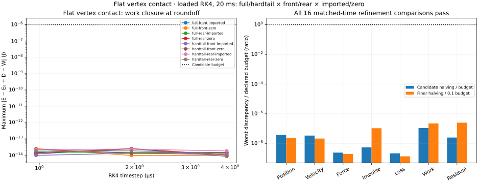

# Flat vertex contact — 2026-11-01

**All 24 loaded plane cases complete, and all 16 timestep comparisons pass the budgets fixed before the mesh sweep.** The [prescribed gap audit](CONTACT_GAP.md) explains why this is a separate contact representation: mesh element weights give a row velocity inconsistent with the capsule gap derivative, whereas native plane rows act directly on vertices. The [failed mesh results](CASING_LOADED.md) remain recorded.



The PNG was inspected for timestep units, the eight wheel/rate cases, residual scale, refinement-budget ratios and readable legends. This is a scientific result plot, not browser receiving. The [receipt](evidence/casing-plane.json) contains eight complete inputs, 24 case summaries/hashes, 16 comparisons and start/end-verified source hashes. The measured source is remote `0d589311ecdb0744130d066bb8408b41dd912f5d`; it precedes the runtime changes below. No end-of-run source substitution was needed.

## Numerical scope

The supplied 64-node front/rear casings from full-suspension and hardtail bikes run for 20 ms with imported or zero node rates. Timesteps are 3.90625, 1.953125 and 0.9765625 µs. Each adjacent pair is compared at all 5,121 common coarse endpoints, including position, velocity, vertical force, accumulated impulse, damping loss and signed contact work. The finer comparison must meet one tenth of the original absolute budgets.

| Quantity | Largest absolute discrepancy across comparisons | Original budget |
| --- | ---: | ---: |
| Node position | 3.82e-15 m | 1e-7 m |
| Node velocity | 3.41e-12 m/s | 1e-4 m/s |
| Vertical force | 1.22e-10 N | 0.05 N |
| Vertical impulse | 1.07e-13 N s | 1e-5 N s |
| Damping loss | 2.18e-15 J | 1e-6 J |
| Signed contact work | 1.10e-13 J | 1e-6 J |
| Maximum work-balance residual | 2.53e-14 J | 1e-6 J |

The reconstructed and native RK4 positions, velocities, final-stage acceleration, warm start and forces agree exactly in every accepted step. Independent Cartesian force, energy and work checks retain their original budgets. The work ledger is `E−E₀+D−W_contact`; native soft contact work is signed mechanical exchange, not a measured storage/dissipation decomposition.

These trajectories retain five contact rows on the front and six on the rear. They do **not** receive contact activation/separation, edge impact or long-duration settling. Refinement reaches floating-point-scale differences in this bounded, unchanged-contact regime; it is not a claim of similarly small physical error. Plane contact changes load distribution and multiplicity, and is not calibrated to a real tyre. No hidden foundation damping was added.

## Versioned runtime

The viewer, worker and CLI now accept `bikelab-fixed-hub-plane-rk4-0.1`, with numerical policy `bikelab-fixed-hub-numerics-0.2` and contact policy `bikelab-flat-vertex-contact-0.1`. Select **Flat vertex contact · RK4** in the fixed-hub station. It admits 1.953125 and 0.9765625 µs steps and at most 20 ms; longer duration controls are disabled for this model. Fresh default examples remain legacy comparisons until browser receiving is completed.

Legacy implicitfast and mesh RK4 records retain their identities and mechanics. Replay checks both the record model and the explicit numerical/contact policy. The new identity binds the finite profile points as well as native geometry and limits: an infinite native plane must not erase authored-domain differences. Each stage and accepted endpoint checks plane/vertex identity, upward normal, geometric gap and unilateral force, in addition to the existing finite-profile, rim, penetration, strain, displacement and movement guards. Unsupported loading stops at the last accepted state and work prefix. It does not invent rim/spoke fracture, pressure loss or continued impossible penetration.

The runtime receiving checks compare all eight supplied wheel/rate cases against the independent plane diagnostic, test strict policy and horizon admission, same-runtime replay, separate contact/domain identities and stage rejection rollback. All 17 focused regression checks pass. Translated-height/rotated-frame checks pass; the 20 ms CLI record replays byte-exactly, and enabling interval measurement leaves all 161 frames, final state and summary identical. Complete Node-suite execution is underway at this checkpoint; process-spawn and loopback failures already prevent a full local attestation. Browser scripts cover the actual 20 ms worker run, progress, desktop/mobile capture, import/export and return to legacy, but execution and visual inspection of those product states remain pending in this environment.

## Reproduction and next work

```sh
node scripts/casing-loaded.mjs artifacts/casing-plane-long .02 plane
node --test --test-isolation=none test/flat-vertex-contact.test.mjs test/tyre-fixture-plane.test.mjs
MPLCONFIGDIR=/tmp/bikelab-matplotlib python scripts/plot-casing-loaded.py artifacts/casing-plane-long
node scripts/tyre-fixture.mjs artifacts/plane-cli-input.json
```

Follow the [complete correction plan](CASING_FIX_PLAN.md). First receive a translating, nonspinning hub using the full coupled mass response and independent absolute-velocity, momentum and energy checks; then spin, both connected bikes and their held rider/buffer forces. Continue long-idle and pose recovery separately. Sharp/faceted terrain needs correct feature gaps/Jacobians and edge-interior support; the flat plane is not its substitute. Layered soil/mud, component failure, eventual 3D lateral/turning forces and measured real-time/multirate performance remain required work toward synthetic data and games.
