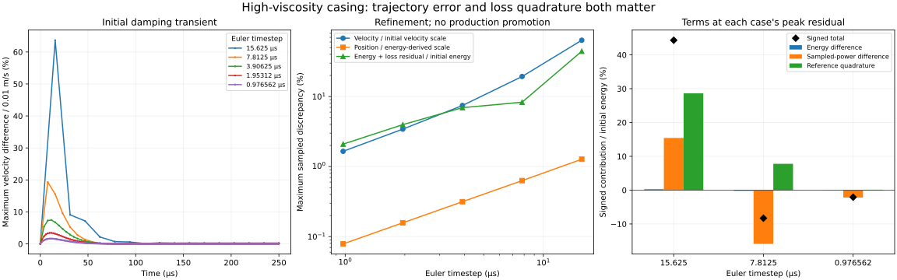

# High-viscosity trajectory and loss refinement — 2026-10-29

**The Euler discrepancy is not solely a loss-quadrature problem.** Relative to a refined independent geometric-force reference, the 7.8125 µs case has a maximum sampled velocity difference of 19.33% of its initial velocity scale. At 0.9765625 µs this falls to 1.652%, while the maximum energy-plus-loss discrepancy remains 2.092% of initial energy. Changing the loss ledger alone would leave the trajectory error intact.

This continues the [isolated Euler study](CASING_EULER.md). All production files, timestep admission, material coefficients, native binaries and legacy record semantics are unchanged. The independent reference is a numerical fixture, not calibrated tyre physics or received bike behavior.

## Reproduction and visible evidence

```sh
node scripts/casing-refinement.mjs artifacts/casing-refinement
node --test --test-isolation=none test/casing-refinement.test.mjs test/casing-euler.test.mjs test/casing-derivative.test.mjs test/tyre-fixture.test.mjs test/tyre-fixture-observation.test.mjs test/tyre-fixture-ui.test.mjs
MPLCONFIGDIR=/tmp/bikelab-matplotlib XDG_CACHE_HOME=/tmp/bikelab-plot-cache python scripts/plot-casing-refinement.py artifacts/casing-refinement
```

The CLI reports each reference level, ten progress intervals per level and all five Euler comparisons. `report.json` contains complete source input, compiled geometry/coefficients, reference convergence, signed contributions and error maxima; five case files add bounded traces, dense through the first 250 µs. The model identity is `bikelab-contact-free-loss-refinement-0.1`. These are diagnostic records for the scientific plotter, not imports for the legacy fixed-hub viewer.



The Matplotlib 3.10.8 PNG was actually inspected for axes, units, early-transient sampling, refinement curves, signed contribution bars and legends. This is figure inspection, not a browser test. The [receipt](evidence/casing-refinement.json) records hashes for the study, inputs, tests and images.

## Independent reference and its limits

The physical setup is the preceding study's 128-node, contact-free ring with edge viscosity 3 N s, zero gravity, fixed unrotated hub, zero initial displacement and alternating ±0.01 m/s x velocities. Duration is 20 ms; initial energy is approximately 5e-5 J. The input's existing 15.625 µs timestep identifies the template; each diagnostic case explicitly records its actual timestep. The additional smaller steps do not change the production parameter range.

The native compiler supplies rest coordinates, node mass, foundation stiffness, edge connectivity/rest lengths and spring/damper coefficients. Executable assertions verify the fixed hub, x/z slides, body/vertex mapping, closed ring, zero spring references/damping/gravity and diagonal mass. The independent JavaScript dynamics then reconstruct the full Cartesian force without calling native force evaluation:

```text
u = (x_j − x_i) / length
lengthRate = u · (v_j − v_i)
edgeForceOn_i = [ke (length − restLength) + c lengthRate] u
edgeForceOn_j = −edgeForceOn_i
foundationForce_i = −k q_i
q' = v;  v' = force / mass;  loss' = Σ c lengthRate²
```

The actual pinned MuJoCo [passive edge-force source](https://github.com/google-deepmind/mujoco/blob/a892750516336d8358949f4518fcc4fbbd85beae/src/engine/engine_passive.c#L729) and [classical RK4 tableau/stages](https://github.com/google-deepmind/mujoco/blob/a892750516336d8358949f4518fcc4fbbd85beae/src/engine/engine_forward.c#L1610) were read before implementation. The independent RK4 integrates accumulated loss using the **same four stages** as position and velocity. It does not attach a lower-order endpoint loss quadrature to the fine reference.

The existing independent exact oscillator checks the two-node relative mode, including both state and physical dissipated energy. Halving its step reduces position, velocity and loss errors at the expected fourth-order rate. For the ring, independent force and energy are compared with native values initially and at every Euler endpoint: maximum discrepancies are below 1e-8 N and 1e-12 J. The two original Euler timesteps reproduce the preceding diagnostic's complete endpoint q/v arrays **exactly**. Independent Cartesian accumulation can differ by floating-point roundoff in the ledger; it does not alter native motion.

Reference steps are 0.48828125, 0.244140625 and 0.1220703125 µs. State, energy, power and cumulative loss are retained on a common 0.9765625 µs grid, with no interpolation. Both adjacent refinements are checked over the full 20 ms grid, including the initial damping transient. Energy closure is additionally checked at every reference step.

Numerical reference budgets were declared before the final study: 1e-10 m position, 1e-7 m/s velocity, 1e-10 J energy/cumulative loss, 1e-6 W power, and 1e-10 J for the difference in reference losses computed with each Euler-grid trapezoid rule. These bound reference uncertainty for this diagnostic, not the required physical accuracy of a tyre or a candidate's acceptance tolerance. Failure of the finest reference comparison aborts the study.

Between the final two reference levels, the largest differences are **7.25e-17 m position**, **6.43e-12 m/s velocity**, **1.09e-13 J cumulative loss** and **1.60e-14 J energy**. The finest every-step energy closure error is **7.25e-15 J**. Power and sampled-loss comparisons also meet their declared budgets. This reference uncertainty is far smaller than the Euler discrepancies discussed below; convergence is numerical evidence, not a proof of exact continuous-time values.

Scratch, stage and trace storage is allocated before integration. Reference stages check finite state, acceleration, edge collapse, strain and displacement; accepted endpoints also run the existing contact-free geometry/movement guards. Native Euler endpoints additionally reject contacts/constraints, clock resets and native warnings. Any reference/domain failure aborts the study rather than writing a successful partial result. A failed RK4 stage preserves its preceding state and observation, but this is not a production replay/rollback API. Adjacent dense reference arrays use about 168 MB at the largest setup, potentially more before garbage collection; this is an offline reference, not a game-memory claim. No performance benchmark was run.

## Signed decomposition at matching times

Let E0 be the common initial energy; E_E, D_E the Euler energy and trapezoidal loss; E_R, D_R the fine-reference energy and stage-integrated loss; and D_RT the trapezoidal loss computed from reference powers sampled at the **same Euler ticks**. At each common time:

```text
Euler residual = reference residual
               + (E_E − E_R)
               + (D_E − D_RT)
               + (D_RT − D_R)
```

The final term measures coarse-grid quadrature along the reference trajectory. The middle loss term measures differing sampled powers under the same quadrature rule. This is a useful bookkeeping decomposition relative to the refined reference, not a unique separation of all error mechanisms. It closes to roundoff; initial energies are checked equal explicitly. Energy and sampled-power differences can cancel each other or the quadrature term.

Each case records signed endpoint contributions, a snapshot at its maximum absolute residual, and separate maxima of each term. **The separate maxima are not added**, because they need not occur at the same time. Maximum component and spatial RMS position/velocity differences are measured independently at every Euler endpoint, so small residuals cannot mask a large state difference. These are sampled-time results, not continuous-time suprema.

## What refinement shows

Position and velocity scales are fixed at 12.2766 µm and 0.01 m/s, derived from initial energy and the compiled mass/foundation stiffness. They never divide by a decaying instantaneous state or energy.

| Euler step, µs | Max position difference, µm | Max velocity difference / initial scale | Max energy-plus-loss discrepancy / initial energy |
| ---: | ---: | ---: | ---: |
| 15.625 | 0.156351 | 63.676% | 44.329% |
| 7.8125 | 0.0773533 | 19.325% | 8.298% |
| 3.90625 | 0.0386631 | 7.448% | 6.938% |
| 1.953125 | 0.0193261 | 3.426% | 3.968% |
| 0.9765625 | 0.00966147 | 1.652% | 2.092% |

Small absolute position differences reflect the deliberately small initial energy; they are not evidence of a calibrated bike trajectory. The velocity error is largest during the initial damping transient. Refinement reduces both state errors, but the residual's reduction is uneven because signed contributions cancel.

At the **7.8125 µs case's peak residual**, time 2.8984375 ms, the contributions are:

| Contribution | Value, µJ |
| --- | ---: |
| Energy difference | −0.0955283 |
| Difference in losses from sampled powers | −7.9460008 |
| Quadrature along the reference | +3.8924099 |
| Reference residual | approximately +7.24e-9 |
| Signed Euler residual | **−4.1491192** |

Thus the quadrature overestimate partly hides the negative sampled-power difference. Substituting a better loss accumulator alone would not remove the velocity error. Even at the smallest new Euler step, the residual remains about 2.1% of initial energy. No new tolerance is selected to label these trajectories physically accepted.

## Checkpoint and next increment

Twenty-one focused tests pass, with no failures or skips. They include the independent exact damped-pair reference, invalid-input and failed-stage preservation, signed-cancellation example, matched-grid reference/refinement, deterministic repeat and prior derivative/Euler/fixture checks. GPT-6.1 Sol independently reviewed the mapping, reference construction, decomposition and allocation behavior. All study source/artifact hashes are checked against the final files.

Next compare a full-force higher-order candidate, initially the pinned native RK4 path, against this fixed reference at the existing diagnostic timesteps. Set state and work budgets before that comparison; retaining damping and completing a run alone are insufficient. If this requires impractical steps, investigate a genuinely coupled damping-aware treatment, preserving the full operator. A qualified contact-free candidate must then receive loaded fixed-hub contact and connected-bike perturbation/work/replay checks before supporting stable rider controls.

PR54 remains draft. Its corrected browser receiver and lifecycle tail are still pending; no new browser/headless agreement, full local attestation, hosted run, physical calibration or game-rate claim follows. The [CI pause](CI_WORKFLOW.md) remains in force. Long idle, independent rider support and recovery, pumping/hops, damage, layered sharp terrain and eventual 3D remain separate whole-system goals.
