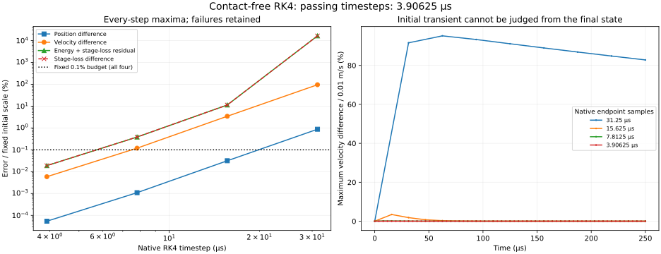

# Contact-free native RK4 screen — 2026-10-29

**Only 3.90625 µs passes all four predeclared numerical budgets in this contact-free high-viscosity case.** The current 7.8125 µs minimum production step still misses velocity and work targets. A completed trajectory at 31.25 µs has a severe work-balance failure and remains explicitly rejected by the screen.

This diagnostic follows the [independent refinement study](CASING_REFINEMENT.md). It compares native MuJoCo RK4 with the same independently reconstructed Cartesian ring reference, without changing production physics, timestep admission or native binaries. Passing this one screen does not qualify loaded contact or a general integrator replacement.

## Reproduction and visual consumer

```sh
node scripts/casing-rk4.mjs artifacts/casing-rk4
node --test --test-isolation=none test/casing-rk4.test.mjs test/casing-refinement.test.mjs test/casing-euler.test.mjs test/casing-derivative.test.mjs test/tyre-fixture.test.mjs test/tyre-fixture-observation.test.mjs test/tyre-fixture-ui.test.mjs
MPLCONFIGDIR=/tmp/bikelab-matplotlib XDG_CACHE_HOME=/tmp/bikelab-plot-cache python scripts/plot-casing-rk4.py artifacts/casing-rk4
```

The CLI reports each reference level, ten progress intervals per level and each native candidate's status. The separate record identity is `bikelab-contact-free-rk4-screen-0.1`. Complete case files include endpoint q/v and traces dense through the first 250 µs; the report retains full authored input, compiled physical coefficients/geometry, source hashes, reference results, screening budgets and all case outcomes. A completed screen exits 0 if at least one candidate passes, or 2 if none passes; failed/terminated cases remain in the output. Unexpected setup/reference errors exit 1. Exit 0 does not imply every case passed or production acceptance.



The Matplotlib 3.10.8 PNG was actually inspected: the logarithmic error axis exposes the coarse failure, all four budgets and the 0.1% threshold are visible, and the early-transient panel distinguishes native endpoint samples from a final-state-only assessment. These diagnostic files are consumed by the scientific plotter, not the legacy tyre viewer. Figure inspection is not browser receiving. [The receipt](evidence/casing-rk4.json) records inputs, outputs, source/test/figure hashes and coverage.

## Predeclared screening contract

Before candidate measurements, fix four maximum-over-endpoints numerical budgets: position difference / initial-energy-derived position scale ≤0.001; velocity difference / initial-energy-derived velocity scale ≤0.001; absolute energy-plus-stage-loss residual / initial energy ≤0.001; and absolute cumulative loss difference / initial energy ≤0.001. These one-part-in-1000 targets make state and work screening explicit. They are not calibrated physical tolerances or production acceptance. Keep all failing cases; do not adjust the thresholds after seeing results.

The timestep set is 31.25, 15.625, 7.8125 and 3.90625 µs. It is an experimental screening set, **not a prior stability certificate**. The Euler admission inequality does not apply to RK4. A constant linearized RK4 map uses the full coupled polynomial `R(hA)=I+hA+(hA)²/2+(hA)³/6+(hA)⁴/24`; scalar damping or stiffness bounds alone do not establish its nonlinear stability or transient behavior.

The reference retains three step levels and the preceding fixed convergence budgets. Its uncertainty budgets must also be below one tenth of each corresponding candidate screen budget. Production's smaller-step boundary is unchanged; the final timestep exists only in this diagnostic.

## Stage work and receiving scope

The actual [pinned RK4 source](https://github.com/google-deepmind/mujoco/blob/a892750516336d8358949f4518fcc4fbbd85beae/src/engine/engine_forward.c#L1610) was read. For the asserted Cartesian slides, its position updates are vector additions, and it applies the complete passive force at four stages.

The public native API does not expose all internal stage powers. A diagnostic geometric RK4 observer therefore starts afresh from each **native pre-step q/v**, with local loss zero. It independently reconstructs the four force stages and their weighted dissipation. Its endpoint must agree with native q/v within 1e-12 m and 1e-10 m/s; independent endpoint force/energy budgets are 1e-8 N and 1e-12 J. The observer never feeds state back into native dynamics. Its work increment enters the accepted ledger only after state, geometry, contact-free and clock checks pass. It additionally checks intermediate shadow geometry; failed stages retain their preceding state/observation.

This is independently reconstructed stage loss, **not native-exposed stage telemetry**. Endpoint agreement alone does not prove identical internal stages; the source mapping, asserted coordinate/force assumptions, force checks and repeated endpoint agreement support this bounded use. Loaded contacts would invalidate the independent shadow force law. The observer adds computation and is not a production performance solution.

## Results

The full sweep uses the preceding study's 128-node ring, viscosity 3 N s, fixed unrotated hub, zero gravity/displacement, alternating ±0.01 m/s x velocity and 20 ms duration. Initial energy is approximately 5e-5 J. Fixed scales are 12.2766 µm position, 0.01 m/s velocity and the initial energy for both work criteria. All four native trajectories complete without warnings or domain termination. Completion is recorded separately from screening success.

Maximum normalized discrepancies over every accepted native endpoint, expressed as percentages:

| Timestep, µs | Position | Velocity | Energy + stage-loss residual | Stage-loss difference | All four ≤0.1% |
| ---: | ---: | ---: | ---: | ---: | --- |
| 31.25 | 0.874872% | 95.1848% | **16409.55%** | **16409.55%** | Fail |
| 15.625 | 0.0315911% | 3.43707% | 11.25994% | 11.26012% | Fail |
| 7.8125 | 0.00109576% | 0.119217% | 0.384907% | 0.384914% | Fail |
| 3.90625 | 0.0000541679% | 0.00589338% | 0.0189263% | 0.0189267% | **Pass for this case** |

The 31.25 µs residual is approximately **0.00820477 J**, about 164 times the 5e-5 J initial energy. Its final position/velocity approach the fine reference closely, but the large early transient and accumulated work error invalidate it. The reported work is the independently reconstructed dissipation along the discrete RK stages, not a claim that the real tyre dissipates this energy. Final-state agreement cannot erase earlier error.

At 3.90625 µs the maximum velocity discrepancy is 5.89338e-7 m/s and the maximum energy-plus-stage-loss residual is 9.46317e-9 J. The unchanged 0.1% screen admits these; it does not establish material fidelity. Endpoint trapezoidal loss remains in each trace as a diagnostic comparison and is **not** used to replace the stage-integrated screen ledger.

The three reference levels and both reference-comparison summaries reproduce the preceding full study **exactly** after sharing its helper functions. The finest closure error remains 7.25e-15 J. Across the candidate sweep, per-step shadow/native endpoint discrepancies are at most 2.86e-20 m and 8.28e-15 m/s; independent force and energy discrepancies are at most 3.02e-13 N and 3.22e-19 J. These comparisons are within the predeclared observer budgets. They support the bounded stage-work reconstruction; they are not direct native stage telemetry.

## Verification, scope and next increment

Twenty-six focused tests pass without failures/skips. New checks preserve passing and failing timesteps, verify both uniform-motion null modes against the exact oscillator (32 nodes, 1 ms), repeat records exactly, reject malformed options, and exercise first-step, later and off-grid rejection with preserved native state/frame/work prefixes. Intermediate shadow-domain rejection restores the preceding observation; injected finite native warnings block a successful screen. Earlier independent reference, Euler, derivative and fixed-hub checks also pass. GPT-6.1 Sol reviewed the source mapping, stage observer, allocation behavior and rejection handling.

Scratch/stage/trace storage is preallocated. The observer adds independent force evaluations and geometry checks; the dense reference retains its offline memory cost. No uncontended performance benchmark was run, and a smaller admissible diagnostic step is not a game-rate result. The native warning/solver bookkeeping is not claimed as a resumable state.

Next build a separately identified **loaded fixed-hub candidate**, beginning with a native-force stage-work observer and an explicit contact-work/energy contract. The present contact-free geometric observer must not be reused as the loaded force law. Compare loaded trajectories at 3.90625 µs and a finer reference, preserving contact/strain/rim/displacement and accepted-command guards; do not silently widen the legacy input range or change old records. Require complete headless/viewer replay before connecting this path to rider perturbation/recovery.

PR54 stays draft. Its corrected browser receiver and remaining lifecycle checks are pending; no new browser/headless receiving, full local attestation, hosted run or deployment is claimed. Long idle, independent rider posture/support, damage, layered sharp terrain, eventual 3D and measured game execution retain their separate gates. Hosted CI remains paused under [the repository policy](CI_WORKFLOW.md).
