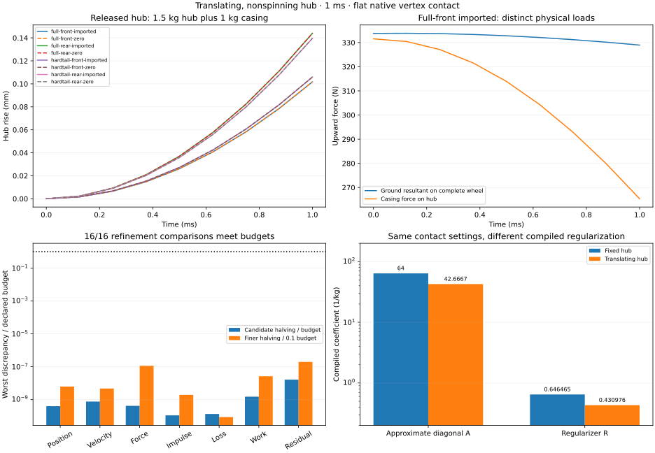

# Translating-hub correction — 2026-11-02

**The hub now moves in the diagnostic, and the full coupled mass/force/work checks pass.** Both the one- and five-millisecond ladders complete all 24 loaded releases and pass all 16 predeclared timestep comparisons. Six focused tests cover analytic motion, native contact coefficients, physical force ownership, strict admission and rejected-step restoration. This is a separate experiment after the [fixed-hub plane result](CASING_PLANE.md); the complete bike and rider remain unchanged.



The final PNG was inspected for SI units, hub displacement, the distinction between ground resultant and casing-on-hub force, declared refinement budgets and the compiled-coefficient comparison. This is an executable scientific consumer of saved records, not product browser receiving. The [receipt](evidence/casing-translate.json) preserves all eight inputs, 24 case hashes/summaries, compiled metadata, comparisons and source hashes verified before and after the study. Repeated inputs and compiled models are deduplicated in the receipt; raw case hashes still describe the complete original records.

## What moves and what is independently checked

The new diagnostic `bikelab-translating-hub-rk4-diagnostic-0.1` adds two hub-local slides while keeping orientation fixed. The hub retains its authored 1.5 kg and the casing its separate 1 kg. There is no hidden bike/rider mass or holding force. Releasing a previously loaded shape changes the boundary: its stored elastic energy can raise this light hub. It is not an idle or equilibrium test.

For hub translations `h` and relative node coordinates `u_i`, physical node velocity is `R(hdot+udot_i)`. The independently assembled mass blocks are `M_hh=M_total I`, `M_hi=m_i I` and `M_ii=m_i I`. The guard verifies the full compiled matrix, then checks the coupled Newton equations without treating the relative nodes as independent fixed-hub masses. Kinetic energy uses absolute velocities; momentum uses the complete wheel. Native-stage contact impulse closes the linear momentum balance, including gravity.

Internal foundation and edge forces, elastic energy and edge damping are reconstructed from geometry. Ground force is summed once over vertices. The physical casing force on the hub is the opposite of the summed internal node forces; hub generalized contact components represent the complete wheel's ground resultant and must not be added again. All generalized velocities participate in signed contact work. World contact velocities, forces, energy and native RK4 stages have independent checks.

An exact common-velocity/free-fall test uses rotated local axes. A separate uniform relative oscillator uses reduced mass `m_h*m_t/(m_h+m_t)` and total foundation stiffness; its COM follows free flight. Edge damping cannot remove this uniform relative mode, so the test deliberately preserves it. Material damping must be separately justified, not inserted to hide a numerical defect.

The initial one-millisecond ladder uses 1.953125, 0.9765625 and 0.48828125 µs. Refinement includes generalized components **and absolute world hub/node vector errors** at every common endpoint. The finer halving must fit one tenth of the original loaded budgets. Largest observed discrepancies are 6.25e-17 m, 7.67e-14 m/s and 5.76e-10 N; maximum work residual is 1.96e-14 J. These are bounded numerical observations, not comparable physical-accuracy claims. All one-millisecond cases retain their initial five front or six rear contact rows; the longer unloading check below now receives contact removal.

## Contact regularization changes with topology

The source prediction in the [translating-hub plan](TRANSLATING_HUB_PLAN.md) is now reproduced in the pinned runtime. Fixed-hub node bodies use the simple-body inverse weight `1/m_i=64 kg^-1`. Once the hub translates, they use the general planar trace average `2/(3m_i)=42.6666667 kg^-1`. With the same time constant and impedance, the native row regularizer changes from approximately `0.646464646` to `0.430976431 kg^-1`.

The diagnostic records both compilations explicitly; it does not claim unchanged normal compliance, silently retune the material or reinterpret existing records. The true normal contact mobility remains `1/m_i`. A source-derived scalar normal-force/reference-acceleration check is a useful next independent check before extending the load claims. The native normal-contact law itself is still uncalibrated.

## Limits, receiving and continuation

Every stage derives the moving hub position for finite terrain, rim, penetration, strain, displacement and movement checks. Vertex identity, normal, gap/rate, unilateral force, solver islands and warnings remain guarded. A rejected stage restores all coupled coordinates, warm start and accepted frame/work/momentum history. Attempted warnings and solver bookkeeping are retained as diagnostics and are not resumable integration state; restoration does not let those counters erase the accepted result.

The CLI prints accepted-step progress and writes complete records. Unsupported initial geometry or input is rejected before running; unsafe subsequent states terminate at the accepted prefix. This does not model fracture, spoke failure, bead unseating or pressure loss, and does not continue through impossible geometry.

```sh
node --test --test-isolation=none test/casing-translate.test.mjs
node scripts/casing-translate.mjs artifacts/casing-translate .001
MPLCONFIGDIR=/tmp/bikelab-matplotlib XDG_CACHE_HOME=/tmp/bikelab-plot-cache python scripts/plot-casing-translate.py artifacts/casing-translate
```

The [five-millisecond receipt](evidence/casing-translate-5ms.json) freezes the measured source at remote `3a20d0d` before further guard changes. All 24 cases complete and all 16 comparisons pass on 2,561 common endpoints each. Rear cases shed two rows (six to four); front cases retain five. Largest discrepancies are 2.83e-11 m, 5.05e-8 m/s and 2.16e-9 N; maximum work residual is 8.84e-14 J. This receives bounded unloading/contact removal, not complete separation and recontact. The [five-millisecond figure](evidence/casing-translate-5ms.svg) was generated and inspected. A source-derived scalar normal-force/reference check is next. Keep longer horizons, spin, connected bikes, active rider stability and product browser receiving open. Fixed orientation permits an external rotational reaction, so angular momentum conservation is not claimed. Preserve the [complete correction sequence](CASING_FIX_PLAN.md), physical failure boundaries, eventual 3D lateral/turning dynamics and measured multirate/game performance gates.
