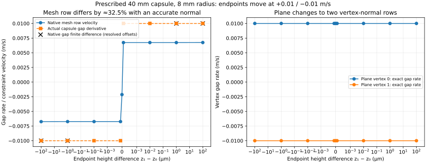

# Contact gap and constraint velocity — 2026-11-01

**The mesh element row does not follow the actual capsule gap derivative in this prescribed two-node case.** With a true gap rate of ±0.01 m/s, the native row uses approximately ±0.00675 m/s: a 32.5% difference even though the normal is vertical to roughly 1e-12. The separate plane representation gives each vertex its own row and exact gap rate.

This isolates a geometric/kinematic inconsistency without integrating a trajectory. It strengthens the contact-representation diagnosis behind the [failed loaded refinement](CASING_LOADED.md). It does not prove that this term alone causes every trajectory difference: plane contact also changes contact multiplicity and eliminates element witnesses.



The final PNG was inspected for signed height/rate axes, the missing derivative at the equal-height tie, finite-difference markers and the two plane rows. The [receipt](evidence/contact-gap.json) contains the complete authored XML, physical parameters, all 18 observations, native contacts/weights/forces, hashes and validation coverage.

## Construction and independent checks

Two independent planar node bodies carry a 40 mm line flex with 8 mm radius, initially penetrating a flat surface by 0.1 mm. Each has mass 0.015625 kg; there is no gravity, foundation/edge force or integration. Prescribed vertical velocities are +0.01 and −0.01 m/s. Endpoint-height offsets range from −100 µm through zero to +100 µm. Material values are illustrative; this is a synthetic constraint test.

For an edge over a flat plane, the geometric capsule gap is `min(z₀,z₁)−radius−groundHeight`. Away from equal endpoint heights, its time derivative is the deeper endpoint's velocity. At equal heights, the minimum has no two-sided derivative for these opposing velocities; that observation is explicitly `null`, not replaced by an average.

Native gap finite differences at resolved ±100 µm and ±1 µm offsets reproduce ±0.01 m/s within 5.3e-10 m/s. Perturbations stay on the same deeper-endpoint branch. Much smaller offsets are retained as raw sensitivity observations; they are not used to claim accurate finite differences below collision/numerical resolution.

In the mesh representation, one element row uses normalized inverse distances from the contact point to the endpoints. At −100 µm, weights are approximately 0.162657/0.837343 and native row velocity is −0.00674685 m/s. Independent weighted-velocity reconstruction matches the native row. The gap derivative is −0.01 m/s. At +100 µm the endpoint roles reverse. The separately checked generalized and row-space powers agree, so the mismatch is not a sign error in the work ledger.

In the plane representation, two rows identify vertices 0 and 1. Every row has normal `[0,0,1]`, gap `z_vertex−radius` and velocity exactly equal to its vertex velocity, including the equal-height configuration. This is a different discretization of contact, not a parity-preserving collision optimization.

## Primary-source mapping

- [Plane-flex collision](https://github.com/google-deepmind/mujoco/blob/a892750516336d8358949f4518fcc4fbbd85beae/src/engine/engine_collision_flex.c#L215) visits vertices, computes normal gaps and records vertex IDs.
- [Collision dispatch/contact construction](https://github.com/google-deepmind/mujoco/blob/a892750516336d8358949f4518fcc4fbbd85beae/src/engine/engine_collision_driver.c#L1975) distinguishes that path from element collision.
- [Convex element collision](https://github.com/google-deepmind/mujoco/blob/a892750516336d8358949f4518fcc4fbbd85beae/src/engine/engine_collision_convex.c#L1657) supplies an element witness.
- [Element vertex weights](https://github.com/google-deepmind/mujoco/blob/a892750516336d8358949f4518fcc4fbbd85beae/src/engine/engine_core_util.c#L616) use normalized inverse distances.
- [Contact Jacobian construction](https://github.com/google-deepmind/mujoco/blob/a892750516336d8358949f4518fcc4fbbd85beae/src/engine/engine_core_constraint.c#L1351) applies the body/vertex weights; a noninterpolated vertex contact has a single-body path.

GPT-6.1 Sol independently reviewed this source mapping. The exact pinned native version remains unchanged.

## Verification and next action

```sh
node scripts/contact-gap.mjs artifacts/contact-gap
node --test --test-isolation=none test/contact-gap.test.mjs
MPLCONFIGDIR=/tmp/bikelab-matplotlib XDG_CACHE_HOME=/tmp/bikelab-plot-cache python scripts/plot-contact-gap.py artifacts/contact-gap
node scripts/casing-loaded.mjs artifacts/casing-plane-long .02 plane
```

Three new tests pass: independent mesh gap/weighted-Jacobian discrepancy, exact plane vertex gradients and deterministic owned records. The preceding loaded/runtime checkpoint has 38 passing focused tests and exact CLI replay. No new browser or performance pass is implied.

Extend the plane sweep to all supplied loaded wheels before exposing a qualified flat-only path. Keep finite terrain/domain, strain, penetration and rim guards even though the native plane is infinite. Preserve the mesh comparison and legacy replay. Then tackle moving/spinning hubs and connected bikes under the [complete correction plan](CASING_FIX_PLAN.md). Sharp edges and faceted rocks require a representation with correct feature gaps/Jacobians and support for edge-interior contact; plane success must not be generalized to those cases.
