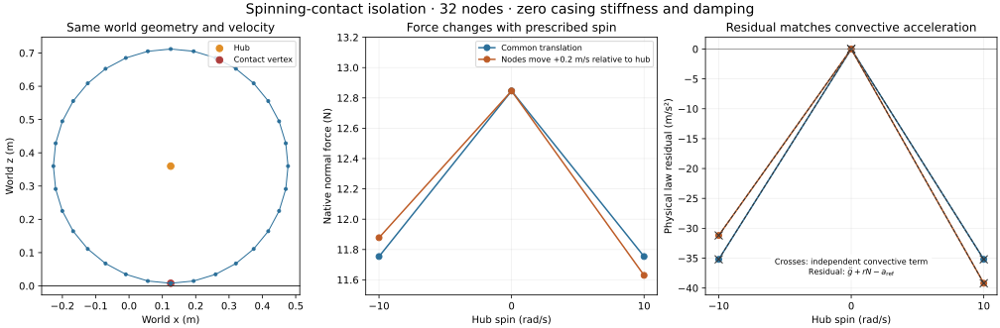

# Prescribed spinning-gap isolation — 4 November 2026

The subsequent [physical-gap target intervention](SPINNING_GAP_TARGET.md) receives 48 prescribed states and reversible native re-solves. This baseline and its source identity remain unchanged.

The planned prescribed-state probe now reproduces a spin-dependent native normal force with **identical world node positions and translational velocities**. The independent convective acceleration accounts for that difference. This is a source-backed diagnosis of the pinned row law, not a corrected production contact law or a spinning trajectory result.



## Control and independent checks

The separate `bikelab-prescribed-spinning-gap-0.1` diagnostic uses the authored 32-node wheel geometry, node/hub masses and rotational inertias. World x is forward, z up; positive spin is about +y. The two world-aligned hub slides precede the hinge. The node bodies share hub rotation but retain their own local x/z slides. The angular inertia includes every node body's authored rotational inertia as well as the hub; node-center orbital inertia is accounted for separately.

Foundation stiffness, edge stiffness and edge damping are explicitly zero **only in this test XML**. Production validation still rejects zero foundation stiffness. This removes material-force changes caused by different relative rates. Gravity, frictionless flat vertex contact and constant native contact impedance remain specified. No integration steps are taken, no native callbacks are replaced, and no reference acceleration is patched.

For each matched world state, the probe reconstructs relative coordinates and rates at hub angles 0 and 0.1 rad and spin −10, 0 and +10 rad/s. It varies six physical/contact cases:

| Case | Native contact requirement |
| --- | --- |
| Common translation | One positive-force row; isolates the even centrifugal term. |
| Relative horizontal velocity | One positive-force row; adds the odd Coriolis term. |
| Deformed ring | Two positive-force vertices; checks independent point mobility and both contact accelerations. |
| Unloading while penetrating | One instantiated row with zero force and satisfied unilateral inequality. |
| Separated and fast closing | No contact or force, despite a positive ungated force prediction. |
| Excluded and fast closing | One native-generated excluded contact, no constraint row or force. A diagnostic detection gap is recorded in its XML. |

All **36 prescribed states** pass the predeclared checks. They retain the existing rim/penetration/domain guards, per-node displacement limit and edge-strain bound. Contact identity and count are explicit acceptance conditions, so a missing intended regime cannot silently pass.

The independent operator is assembled from kinetic-energy point Jacobians and authored rotational inertia, then compared with `mj_fullM`. An independently derived inverse is checked against arbitrary generalized forces. Bias, contact Jacobians, exact point mobility, native inverse-weight approximation, regularization, force and power are checked separately. World accelerations are reconstructed from coordinate accelerations plus convective acceleration. Central differences of native body-center velocities check node 0 and every active contact vertex at two small prescribed-path offsets. These are kinematic finite differences, not timestep convergence or trajectory integration.

## Result and interpretation

With `S(x,z)=(z,−x)`, local node position `b`, local relative rate `u_dot` and rotation `R`, the convective term is:

```text
c = R (2 omega S u_dot − omega² b)
u_dot = Rᵀ (v_world − V_hub) − omega S b
```

At a positive-force contact, the pinned native row uses coordinate acceleration. For this zero-material control, with node mass `m`, gravity `g` and regularizer `r`:

```text
J qacc_smooth = −g − c_z
N_native = max(0, (aref + g + c_z) / (1/m + r))
physical gap acceleration = −g + N_native/m
physical gap acceleration + r N_native − aref = c_z
```

That final equality applies to positive-force rows. Zero-force, excluded and absent cases use their own unilateral/admission checks. The approximate native diagonal `2/(3m)` is independently distinguished from exact point mobility `1/m`.

For the bottom vertex, centerline radius is 0.352 m. At spin ±10 rad/s with common world translation, the physical-law residual is **−35.2 m/s²**. The normal force changes from **12.846214 N** at zero spin to **11.753572 N** at either spin sign. With fixed +0.2 m/s relative horizontal world velocity, the residuals are **−31.2** and **−39.2 m/s²**, and normal forces are **11.877736** and **11.629408 N** at −10 and +10 rad/s. Changing the hub angle to 0.1 rad preserves the matched physical result within the declared checks.

Largest independent force discrepancy is **4.86e-12 N**; linear acceleration discrepancy is **1.56e-10 m/s²**. Native velocity finite differences differ by at most **5.42e-6 m/s²**, within the fixed 1e-5 budget. Force variation with spin is therefore much larger than the checked reconstruction errors. [Complete evidence](evidence/spinning-gap.json) retains all inputs, XML, states, row data, native/source identities, budgets with SI units and finite differences.

The result supports the source prediction: to express this particular reference law in physical gap acceleration, its coordinate-row target would need `aref − c_z`. That is a prospective model decision. A correction must be separately versioned and evaluated before every relevant constraint solve, including every native RK stage. Changing an observer alone would not implement that law. This experiment neither proves that any general terrain law should use this specific acceleration reference nor establishes physical calibration.

## Reproduction, verification and next work

```sh
node scripts/spinning-gap.mjs artifacts/spinning-gap
python scripts/plot-spinning-gap.py artifacts/spinning-gap
node --test test/spinning-gap.test.mjs
```

The CLI reports each of 36 states and rejects failed checks. Plotting reads the saved report only. Four focused tests pass: matched-state even/odd controls, unilateral contact regimes, exact same-runtime replay and owned output/progress, and deliberate corruptions of native bias and hinge Jacobian. GPT-6.1 Sol reviewed the derivation and code; its contact-regime and second-contact finite-difference findings are included.

The complete in-process Node suite reports **409/422 passes**, with the same **13 environment-blocked failures** as the preceding main-tree run: twelve subprocess tests and the real loopback test. No skips or cancellations. This is not a full-local attestation or new browser receiving. [Verification receipt](evidence/spinning-gap-tests.json) records source and log identity. Production `dist/`, server, workflows and existing tests are unchanged. The published source is `f2cd86e751be369e9f8d1e436951580d5a5805cb`; following changes add only documentation, saved evidence and its plotting tool.

Next: specify and test a versioned physical-gap contact target with a supported stage-evaluation path, then receive ballistic/centrifugal controls, loaded spin/refinement, both connected bikes and held-control/continuous-buffer work. Physically specified 10 s rest and eventual 60 s active-rider idle/recovery remain separate gates. Suspension/rim/casing limits, calibrated breakage/blowout, faceted/layered terrain, independent rider ownership and eventual 3D lateral/turning forces remain required. No real-time benchmark or supported manoeuvre claim follows from this prescribed-state probe.

The archived macOS legacy replay comparison remains pending: the diagnostic artifacts exist, but the network-enabled download request was cancelled in this workspace. No hash, tolerance or platform failure has been changed or declared resolved by this work.

Primary sources are pinned MuJoCo `a892750516336d8358949f4518fcc4fbbd85beae`: [reference acceleration and equality-only correction](https://github.com/google-deepmind/mujoco/blob/a892750516336d8358949f4518fcc4fbbd85beae/src/engine/engine_core_constraint.c#L3189), [constraint RHS](https://github.com/google-deepmind/mujoco/blob/a892750516336d8358949f4518fcc4fbbd85beae/src/engine/engine_forward.c#L1228), and the mass/inertia references in the [spin plan](SPINNING_HUB_PLAN.md).
