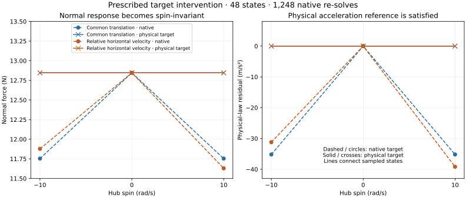

# Physical-gap target intervention — 4 November 2026

Changing only the coordinate contact target to `native_aref − convective_z` removes the spin-dependent normal-force change in the supplied prescribed-state controls. **All 48 states pass**, including **1,248 native constraint re-solves** under five reseeded warm-start modes and repeated/restored target sequences. This is an implemented diagnostic intervention, not a production contact correction or a trajectory result.



## Controlled intervention

The [preceding 36-state baseline](SPINNING_GAP.md) and its source-bound report are unchanged. The new runner checks their source hashes and compiled XML, restores their exact saved q/v, and reproduces the native outputs exactly on the tested runtime. Twelve additional, explicitly labelled closing/opening controls supply nonzero signed contact power. Their world velocities are independently checked through native body-center velocity queries.

The probe uses the exposed `mj_fwdConstraint` function. It derives the convective term from current compiled geometry and relative rates, assigns the corrected target from an immutable copy of the original target, and asks the native solver to solve again. It does not assign forces analytically, edit `efc_b`, change contact discovery, advance time or modify production runtime files. The independent force/acceleration oracle uses authored world geometry and the coupled inverse received by the baseline.

For this zero-material, constant-impedance, frictionless plane control:

```text
corrected_coordinate_target = native_aref − convective_z
N = max(0, (native_aref + gravity) / (1/node_mass + regularizer))
physical_gap_acceleration = −gravity + N/node_mass
slack = physical_gap_acceleration + regularizer*N − native_aref
```

The checks require nonnegative force and unilateral slack; positive force requires zero slack within the unchanged acceleration budget. The original physical target remains the reference for that assessment. Comparing physical acceleration against the corrected coordinate target would test a different equation.

## Receiving and result

Each case retains the existing geometry, rim, penetration, displacement, strain and finite-domain guards. Original loaded, two-contact, zero-force unloading, absent-contact and native-excluded regimes are checked explicitly. Closing speed alone cannot create a contact row.

The following remain exactly unchanged during each intervention: time, q/v, activation and applied inputs, full native mass matrix, bias/smooth dynamics, geometry, Jacobian, contact identity/exclusion, row position/velocity/margin and regularization. This WASM does not expose `qM`; the mass snapshot uses `mj_fullM`. Independent reconstructed `JᵀN`, coupled acceleration, world acceleration and signed power must agree with native results.

Warm-start controls use zero, original-solve, corrected-solve and unrelated finite acceleration seeds, plus warm-start disabled. Every solve is explicitly reseeded. Target sequences repeat the corrected solve, restore the native target and reverse the solve ordering; the original result returns. These are seed/order independence controls, not an evolving trajectory's warm-start lifecycle.

| Check | Maximum discrepancy |
| --- | ---: |
| Physical normal force across matched spin/angle states | 5.54e-12 N |
| Physical world acceleration across matched states | 1.54e-10 m/s² |
| Independent normal/generalized force | 5.22e-12 N |
| Independent generalized torque | 4.11e-14 N m |
| Independent acceleration | 1.56e-10 m/s² |
| Signed contact power | 3.89e-15 W |

The bottom-node common-translation response returns to approximately **12.846214 N** for all three spin values. Original native force still varies from 12.846214 N at zero spin to 11.753572 N at ±10 rad/s. The baseline is retained alongside the intervention, not overwritten or declared inaccurate by comparison alone. This result receives the stated physical-gap reference for these controls; it does not select a calibrated tyre law for arbitrary terrain.

[Complete evidence](evidence/spinning-gap-target.json) retains all 48 inputs, XML, native and corrected states/rows, warm-start sequences, immutable source identities and dimensioned checks. Matched forces are compared by vertex identity. The committed JSON is compact serialization of the complete raw report; values are unchanged. No sampled records or failed baseline are discarded.

## Tests and reproduction

```sh
node scripts/spinning-gap-target.mjs artifacts/spinning-gap-target
python scripts/plot-spinning-gap-target.py artifacts/spinning-gap-target
node --test test/spinning-gap.test.mjs test/spinning-gap-target.test.mjs
```

Eight focused tests pass: the four original controls plus target force/invariance and exact baseline reproduction, signed power/unilateral/reversal controls, exact repeatability/owned data/progress, and deliberate missing/no-op solve API or state/coefficient corruption. GPT-6.1 Sol reviewed the implementation; its native velocity, vertex identity and dimensioned warm-start reporting findings are addressed.

The source checkpoint is `728b68d4891796f8640cc2c65d651249458252e7`, tree `79bd722ffa7908c1fbc615e2b32a2e3beb4d8cf1`. Full-suite receiving is recorded in [the test receipt](evidence/spinning-gap-target-tests.json). This diagnostic adds no browser or physical calibration claim. Existing macOS legacy and rider replay failures remain unresolved; no baseline hash, production force law or acceptance budget changes.

## Stage boundary and next implementation

The pinned [constraint solve](https://github.com/google-deepmind/mujoco/blob/a892750516336d8358949f4518fcc4fbbd85beae/src/engine/engine_forward.c#L1211) rebuilds `efc_b` from the changed target before warm-start selection, including its Newton island path. Rebuilding native references through `mj_referenceConstraint` restores the original target and original response in every case. Therefore this patch is not persistent through native RK4, which [rebuilds references at its later stages](https://github.com/google-deepmind/mujoco/blob/a892750516336d8358949f4518fcc4fbbd85beae/src/engine/engine_forward.c#L1664).

The next pilot must use a separately identified restricted stage driver. First receive uncorrected parity against native RK4, then corrected contact-free ballistic and later loaded controls. Native RK4's accepted q/v/time are endpoint state, but `qacc` and `qacc_warmstart` retain fourth-stage acceleration; contact/force caches also remain fourth-stage data. The weighted acceleration is passed separately to `mj_advance`. Keep incoming warm-start unchanged through all four stage solves, and observe endpoints in separate data. A failure must restore accepted state/time/warm-start transactionally.

No JavaScript control/passive callback setter was found. `mj_step1/2` is not a valid RK4 replacement: that path advances RK4 selections with Euler. A new stage driver must preserve explicit topology, stage order, force/work accounting, warning/limit guards, replay and rollback; it must not pretend to be unchanged native `mj_step`. [Tracked working plan](working/SPINNING_CONTACT.md) records this pending boundary and the wider connected/rest, rider, physical failure, terrain and 3D gates.
