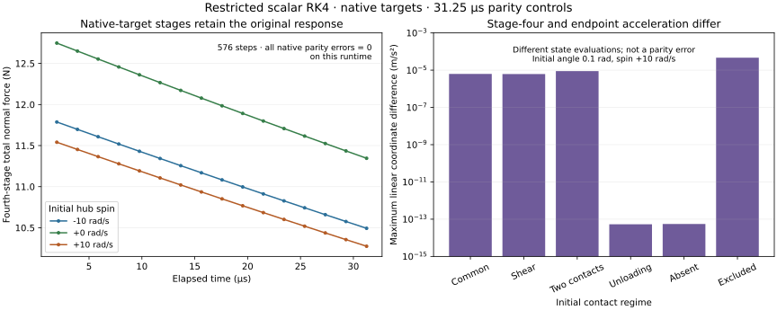

# Scalar spinning RK4 stage pilot — 4 November 2026

A restricted diagnostic driver now reproduces native RK4 while retaining accepted state on rejection. **All 36 starting states match native outputs over 16 consecutive steps each: 576 steps.** Every measured parity discrepancy is zero on this runtime, within the predeclared budgets. **Six independent free-flight controls pass another 768 steps.** This receives the integration and state-ownership foundation; the physical-gap target is not yet applied during these trajectories.



The [prescribed target intervention](SPINNING_GAP_TARGET.md) remains the preceding law control. Its baseline, source hashes and evidence are unchanged. This pilot uses a new identity, `bikelab-scalar-spinning-rk4-stage-0.1`, and changes no production files or acceptance budgets.

## Integration and ownership contract

The privately built model is exactly the received zero-material XML: world x/z hub slides, one +y hinge and two local slides per node. It has no actuation, history, plugins, sensors, equality/tendon constraints, sleeping, friction loss or external applied forces. The fixed step is 1.953125 µs. Arbitrary models, external native callbacks and timestep/options changes are outside this API. Dimension/topology, options, finite state, warnings, convergence, contact identity, finite domain, rim/casing geometry, displacement, strain, penetration and motion-resolution guards remain active.

The implementation follows the pinned native [RK4 tableau and call order](https://github.com/google-deepmind/mujoco/blob/a892750516336d8358949f4518fcc4fbbd85beae/src/engine/engine_forward.c#L1623), including its [state advancement and warm-start convention](https://github.com/google-deepmind/mujoco/blob/a892750516336d8358949f4518fcc4fbbd85beae/src/engine/engine_forward.c#L1467). Positions and velocities are scalar coordinates, so the admitted position integration is ordinary addition; this does not extend to quaternion/free joints.

1. Reset trial data and copy the accepted integration state through the verified exposed `mj_copyState` API. `mj_copyData` is unavailable.
2. Evaluate stage zero with full forward and the remaining stages with `mj_forwardSkip(NONE, 1)`, at offsets 0, h/2, h/2 and h. Every stage retains the same incoming warm-start.
3. Form weighted endpoint q/v. Keep the fourth-stage acceleration and force/contact caches; store fourth-stage acceleration as the next warm-start. Native RK4 does not store the weighted acceleration in `qacc`.
4. Validate the endpoint using a third, separate observation data object. This leaves the trial's retained fourth-stage caches intact.
5. Swap accepted/trial ownership only after all checks pass. State, time, slot identity, force/work ledgers and the last committed trace remain unchanged on failure. Retry starts from reset scratch data.

Reported snapshots and observations own their arrays. Per-stage solver scratch is allocated when the driver is created; this is still an allocation-heavy diagnostic recorder, with no real-time performance claim. The synchronous checkpoint hook is only for diagnostic failure injection.

## Receiving

The native comparison reuses all 36 saved prescribed inputs, with two initial orientations, three spin values and six contact regimes. A deterministic nonzero warm-start exercises repeated integration ownership. Each accepted step checks q/v/time, acceleration/warm-start, smooth/bias/contact forces, row targets/coefficients/Jacobian/gap/velocity, contact counts and cached vertex geometry. Linear and angular quantities have separate SI units and budgets. Starting contact regimes are not required to persist throughout the 31.25 µs run: the six initially excluded, fast-closing cases acquire active rows. That is parity coverage of a transition, not independent contact-entry law/refinement receiving.

This is native parity, not an independent endorsement of the native contact target. The spin-dependent force response isolated in the preceding diagnostic is intentionally preserved. Native data and independently reconstructed stages are both recorded.

Free-flight controls start from the six separated, closing states and run for 0.25 ms without reaching the plane. Independent world ballistics check every hub/node position and velocity at every endpoint, constant spin, zero contact force, and exactly zero contact work/impulse. Maximum discrepancies are:

| Independent free-flight check | Maximum discrepancy |
| --- | ---: |
| Position | 5.56e-16 m |
| Velocity | 5.94e-15 m/s |
| Hub angle | 5.00e-16 rad |
| Hub angular velocity | 1.57e-19 rad/s |

The cache distinction is measurable: the loaded two-contact +10 rad/s, 0.1 rad case differs by approximately 8.91e-6 m/s² between retained fourth-stage and recomputed endpoint linear acceleration after 16 steps. Endpoint observation must not overwrite the integration data merely because their timestamps coincide.

Six new tests cover the full parity matrix, rejection at each of four stages and the endpoint, deterministic retry, observation/output ownership, independent ballistics, corrupted warm-start, native warnings, nonfinite endpoint, unavailable copy API, unsupported inputs and physical limits. **All 14 combined focused tests pass**, including the earlier eight prescribed-state controls. GPT-6.1 Sol reviewed stage semantics, lifecycle, units and ballistics; its original-input hash finding is addressed.

The complete Linux in-process suite is **419/432**, with the same thirteen environment-blocked checks; see the [test receipt](evidence/spinning-rk4-stage-tests.json). The upstream [Windows receipt](evidence/spinning-rk4-stage-receiving.json) records **432/432** and exactly the same complete report hash. Both source-bound receipts are preserved; this is not browser/full attestation. Code source is `83c80605b5937c9e9f47003b3c1a4c4fae022cab`, tree `244fd85018f3840b3b07955794f4a7a06aee29d1`. Existing environment-blocked, legacy macOS and rider replay checks remain separate. No browser receiving or full attestation is implied.

## Evidence and reproduction

The [complete report](evidence/spinning-rk4-stage.json.gz.base64) is losslessly compressed and Base64-encoded for text publication; decoding and decompression reproduce the original report bytes, with both hashes recorded in the test receipt. It retains every input, all step/stage summaries and comparisons, final reconstructed/native/cache/endpoint states, independent ballistic results, baseline identity and source hashes. No cases or failed controls are removed. Its XML is identified by the unchanged source-bound baseline report.

```sh
node scripts/spinning-rk4-stage.mjs artifacts/spinning-rk4-stage
python scripts/plot-spinning-rk4-stage.py artifacts/spinning-rk4-stage/report.json
node --test test/spinning-gap.test.mjs test/spinning-gap-target.test.mjs test/spinning-rk4-stage.test.mjs
# Render the committed evidence without running physics:
python scripts/plot-spinning-rk4-stage.py docs/evidence/spinning-rk4-stage.json.gz.base64 artifacts/spinning-rk4-stage
```

## Next gate

PR91 separately applies the physical-gap target to freshly constructed references before every affected stage constraint solve under a separately named policy. Receive unchanged native-policy parity, zero-spin recovery and corrected contact-free controls first. Loaded trajectories then need independent physical acceleration/unilateral checks, signed work/impulse and linear/angular momentum, refinement, physical limits, retry/replay and contact-entry/recontact receiving. The original failed native physical-law response remains evidence; do not loosen its budget or reinterpret this native-parity result as its fix.

Long supported rest, connected bikes, independent active rider, calibrated component failure/pressure loss, faceted/layered terrain, 3D turning/lateral forces and game/reference-data performance remain in the [working plan](working/SPINNING_CONTACT.md) and [roadmap](ROADMAP.md). This short, zero-material, frictionless planar pilot qualifies none of those systems.

User-priority [issue95 pressure/material work](working/TYRE_PRESSURE.md) is the next task for this session; it must preserve PR91 rather than duplicate that implementation.
